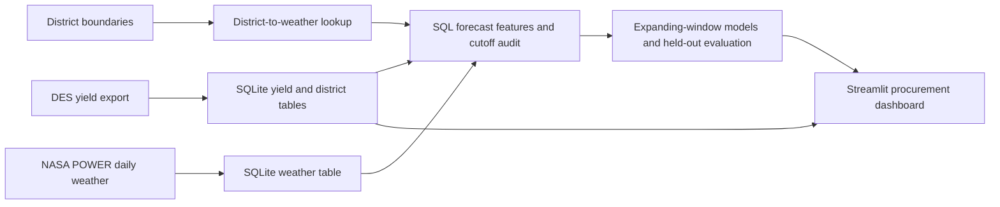

# Tamil Nadu Kharif Rice Yield Forecast

A SQL-backed forecasting project for historical procurement planning. On
1 September of each crop year, the system forecasts district-level Kharif rice
yield in kg/ha and gives a prediction range. When the required yield history is
missing, the dashboard asks the user to obtain a current district estimate.

## Architecture



## Data and licences

- **Yield:** [Directorate of Economics and Statistics APY Query Report](https://data.desagri.gov.in/website/apy-query-report-web).
  Select **Tamil Nadu**, **All Districts**, **Rice**, **Kharif**,
  **1998–99 through 2022–23**, and **All Type**. Use the same tabular export and
  save it as `data/raw/apy_query_report.xls`. The file contains an HTML table.
  Redistribution terms for this exact report export remain unverified.
- **Weather:** [NASA POWER daily API](https://power.larc.nasa.gov/docs/services/api/temporal/daily/).
  Daily temperature and corrected precipitation from 33 grid cells.
  NASA POWER data are listed as [CC BY 4.0](https://aws.amazon.com/marketplace/pp/prodview-agetvmpkkzb7a).
- **District boundaries:** [geoBoundaries India ADM2](https://www.geoboundaries.org/api/current/gbOpen/IND/ADM2/),
  release `IND-ADM2-76128533`, representing 2021. The release metadata lists
  the Open Database License 1.0. The raw downloads stay outside Git.

## Reproduce locally on Windows

From the repository root in PowerShell, with Python 3.12:

```powershell
python -m venv .venv
.\.venv\Scripts\python.exe -m pip install -r requirements.txt
.\.venv\Scripts\python.exe run_pipeline.py --download-weather
.\.venv\Scripts\python.exe -m unittest discover -s tests -v
.\.venv\Scripts\python.exe -m streamlit run app/streamlit_app.py
```

Place the DES export in `data/raw/` before running the pipeline. The weather
flag downloads missing inputs and reuses its cache on later runs. With all raw
inputs cached, run `run_pipeline.py` without the flag for an offline rebuild.
The command writes the database and regenerated test CSVs to `data/processed/`.

## Evaluation

Development used expanding windows for crop-year starts 2012–2017. The
2020–2022 test used the frozen model choices. Weather features use observations
through 31 July. Yield features use observations at least two crop years old,
with a three-year sensitivity check for the development baselines. Fitted
models use labels through 2019 at the latest. Eligible earlier test-year
observations can enter later history features in the sequential simulation.

On the final test, errors below use the same 93 district-years. Coverage is
reported separately against all 113 observed outcomes.

| Method | Forecasts / observed | MAE (kg/ha) | Exploratory 95% MAE CI |
|---|---:|---:|---:|
| Last available | 100/113 | 482.10 | 355.15–551.15 |
| Trailing average | 93/113 | 483.91 | 425.20–525.77 |
| Exponential smoothing | 93/113 | 409.77 | 375.43–432.56 |
| LightGBM history only | 113/113 | 397.19 | 337.78–446.84 |
| LightGBM history + weather | 113/113 | 357.46 | 330.68–376.30 |

The trailing average was selected by development MAE. Its nominal 90%
prediction interval covered 91 of 93 observed test forecasts. LightGBM with
weather scored lowest on this test, reversing the development ranking.
See [final evaluation](reports/final_test_summary.md) for RMSE, MAPE, and group results.

## Limitations

- Three held-out years give limited information about uncertainty across
  future seasons. The MAE intervals resample whole test years.
- The trailing average forecast only 6 of 26 observed limited-history rows.
  It underforecast the Ramanathapuram and Sivaganga rebounds in 2020–21.
- Historical DES release dates are unverified. NASA historical observations may
  include later revisions, and the weather cells use 2021 district geography.
- MAPE is sensitive to near-zero actual yields. Exponential smoothing emitted
  two convergence warnings in the held-out run.
- The dashboard is a historical demonstration. A procurement volume decision
  also needs current harvest area and local supply information.
