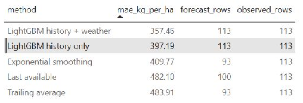
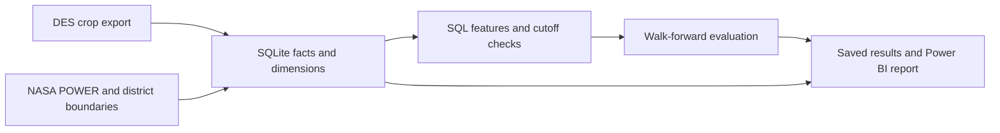

# Tamil Nadu Rice Yield Forecast

Forecast district-level Kharif rice yield for September procurement planning, with a reproducible SQLite pipeline and a Power BI report that explains each forecast.

   

## Results at a glance

**38 districts · 950 district-year slots · 296,274 daily weather records**

| Method | Test MAE (kg/ha) | Exploratory 95% MAE CI | Observed rows forecast |
|---|---:|---:|---:|
| Trailing average · selected on development | 483.91 | 425.20–525.77 | 93/113 |
| LightGBM with weather · lowest held-out MAE | 357.46 | 330.68–376.30 | 113/113 |

MAE is the average absolute forecast error. Both scores use the same 93 observed district-years from 2020–21 through 2022–23. Coverage counts use all 113 observed outcomes. The trailing average was selected before testing, and its nominal 90% prediction interval covered 91 of its 93 observed forecasts. [Full model comparison and limitations](reports/final_test_summary.md)

## What it does

- Joins government crop statistics with NASA POWER temperature and rainfall in SQLite. Each forecast uses weather observations through 31 July and yield history at least two crop years old.
- Compares two baselines, exponential smoothing, and two LightGBM variants using expanding training windows. The weather ablation compares LightGBM with and without weather on identical rows.
- Shows the forecast range, the three source seasons, and a procurement action in Power BI. When eligible history is incomplete, the app asks for a current district estimate before setting a volume target.

## Power BI report

The [Power BI project](powerbi/Tamil%20Nadu%20Rice%20Forecast.pbip) has two pages. **District Forecast** shows the eligible yield history, the three seasons behind the forecast, an uncertainty range, and a procurement action. **Model Comparison** shows the held-out MAE and forecast coverage for all five methods. The report runs in Power BI Desktop. The [evaluation summary](reports/final_test_summary.md) is also available directly on GitHub.



## Architecture



| Path | Role |
|---|---|
| `sql/` | Data quality checks, district joins, time windows, and cutoff audits |
| `src/` | Input downloads, database rebuild, forecasting, and scoring |
| `powerbi/` | Power BI report and semantic model definitions |
| `app/` | Optional Streamlit dashboard |
| `tests/` | Metric, data-quality, and dashboard tests |
| `reports/` | Frozen evaluation plan and measured results |

## Tech stack

- **Data and geography** · Python 3.12 loads the DES export and NASA JSON. SQLite stores and joins the data. Shapely picks an interior point for each district.
- **Forecasting and evaluation** · NumPy prepares model inputs, statsmodels fits exponential smoothing, and LightGBM fits CPU gradient-boosted trees.
- **Presentation and testing** · Power BI Desktop and DAX present forecast scenarios. Python unittest checks metrics and data cutoffs, and AppTest checks the optional Streamlit dashboard.

## Quick start on Windows

From PowerShell with Git and Python 3.12 installed:

```powershell
git clone https://github.com/bharath-sharma0/tamil-nadu-rice-forecast.git
cd tamil-nadu-rice-forecast
python -m venv .venv
.\.venv\Scripts\python.exe -m pip install -r requirements.txt
New-Item -ItemType Directory -Force data/raw | Out-Null
```

In the DES APY Query Report, choose **Tamil Nadu → All Districts → Rice → Kharif → 1998–99 through 2022–23 → All Type**. Download the tabular export and save it as `data/raw/apy_query_report.xls`. Its contents are HTML. [DES APY Query Report](https://data.desagri.gov.in/website/apy-query-report-web)

Then run:

```powershell
.\.venv\Scripts\python.exe run_pipeline.py --download-weather
.\.venv\Scripts\python.exe -m unittest discover -s tests -v
.\.venv\Scripts\python.exe src/export_powerbi.py
```

The first run downloads missing weather and boundaries, builds SQLite, and regenerates the test CSVs. Omit `--download-weather` for an offline rebuild once the inputs are cached. No API keys are required.

1. Open `powerbi/Tamil Nadu Rice Forecast.pbip` in the free Power BI Desktop app.
2. Under **Home → Transform data → Edit parameters**, set **CsvFolder** to the absolute path of your checkout's `data/processed/powerbi` folder. Apply the change and select **Refresh**. In Power Query, the same parameter is available under **Manage Parameters**.
3. Select **Ramanathapuram, 2020** to check the **242.33 kg/ha** forecast. Select **Chengalpattu, 2020** to check the insufficient-history message.

The exported CSVs and Power BI's imported-data cache are local. Before committing changes to the report definitions, reset `CsvFolder` to the generic value `C:\PowerBI\csv`.

To use the optional Streamlit dashboard, run `.\.venv\Scripts\python.exe -m streamlit run app/streamlit_app.py`.

## Engineering decisions

- **Forecast-time availability.** SQL records the latest source date or year used by each feature. Automated checks verify the cutoffs. Development used 2012–2017, with three later test years scored under frozen model choices.
- **Coverage and error are separate.** Comparing methods on shared rows keeps missing forecasts from changing the error ranking. The selected model forecast only 6 of 26 observed rows in the limited-history group, which the aggregate MAE alone would hide.
- **Reuse work across folds.** Materializing the SQL feature view once per evaluation avoids rebuilding it for every LightGBM fit. The one-command rebuild regenerated both final test CSVs byte for byte in the verified environment.

## Data sources and limitations

- **DES crop statistics** · The exact export's redistribution terms remain unverified. Historical release dates are also unverified, so the evaluation assumes a two-crop-year reporting delay and checks a three-year alternative for the development baselines. [DES website policy](https://desagri.gov.in/website-policies/)
- **NASA POWER weather** · Corrected precipitation and temperature are sampled at 33 grid cells. Historical values may include later revisions. NASA POWER data are listed as CC BY 4.0. [Daily API](https://power.larc.nasa.gov/docs/services/api/temporal/daily/) · [License and attribution](https://aws.amazon.com/marketplace/pp/prodview-agetvmpkkzb7a)
- **geoBoundaries** · The 2021 India ADM2 release `IND-ADM2-76128533` lists ODbL 1.0. Modern district geometry may differ from historical boundaries. The downloader verifies the expected release. [Release metadata](https://www.geoboundaries.org/api/current/gbOpen/IND/ADM2/)
- **Evaluation** · Three test years limit the usefulness of the uncertainty estimates. Near-zero actual yields can dominate MAPE, and exponential smoothing emitted two test-fit convergence warnings. The dashboard is a historical demonstration. [District-group metrics](reports/final_test_metrics.csv)

See [CONTRIBUTING.md](CONTRIBUTING.md) for test and documentation guidance.
